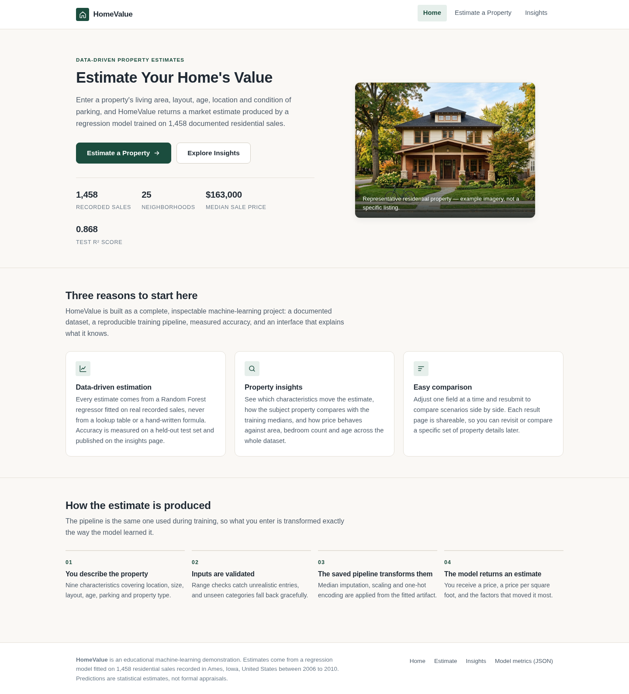
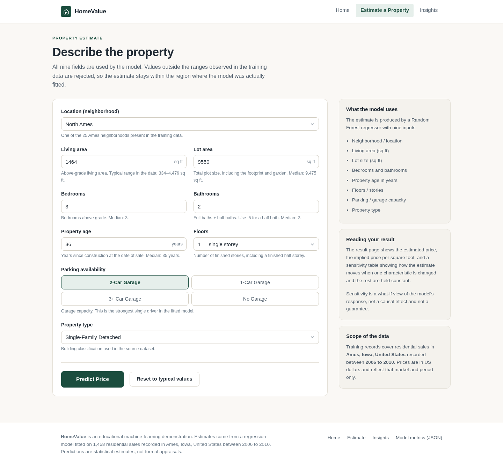
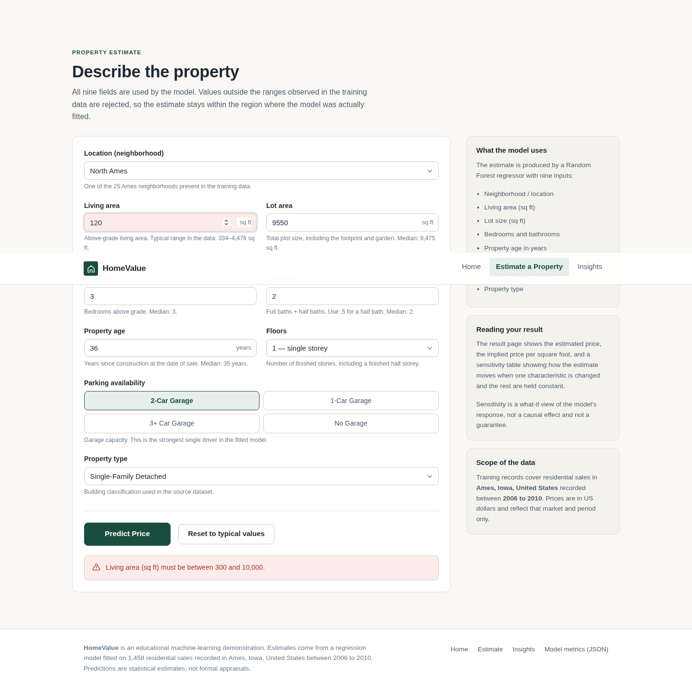
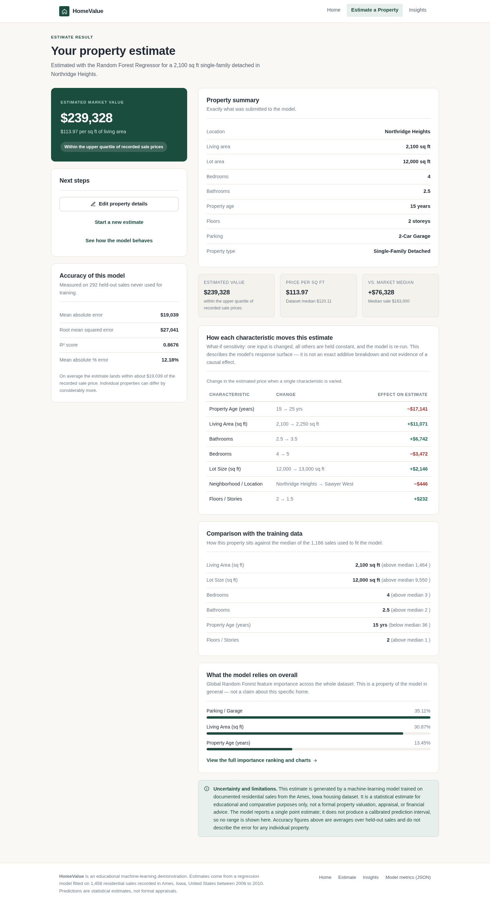
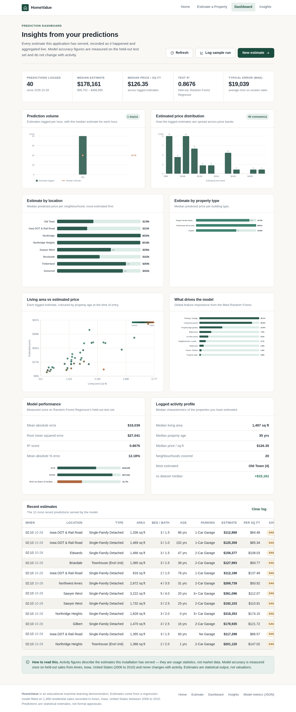
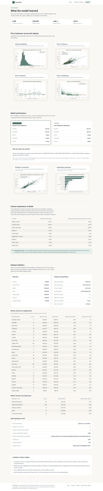
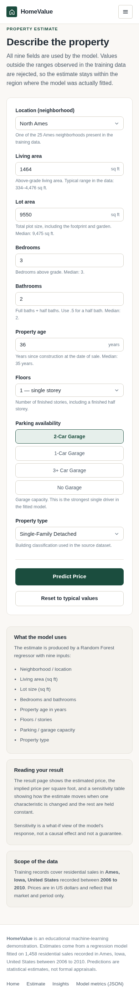

# HomeValue — House Price Prediction System

A complete, working full-stack machine-learning application that estimates residential property values.
Users describe a property in a web form, a saved Scikit-learn pipeline transforms those inputs exactly as
it did during training, and a Random Forest regressor returns an estimate together with a
model-derived explanation.

The project is built to be readable and demonstrable: every number shown in the interface comes from the
real dataset or the real fitted model, and every step from raw CSV to saved artifact is reproducible with
two commands.

> **Looking for the full write-up?** [`docs/HomeValue_Project_Documentation.pdf`](docs/HomeValue_Project_Documentation.pdf)
> is a 44-page technical document covering the architecture, the complete ML pipeline, a worked prediction
> example, and a detailed explanation of every technology and algorithm used (ordinary least squares,
> recursive binary splitting, bagging, impurity and permutation importance, the four evaluation metrics,
> and each preprocessing component). Regenerate it at any time with
> `python docs/generate_documentation.py` — it reads directly from the saved artifacts.

---

## 1. What the application does

| Page | Route | Purpose |
| --- | --- | --- |
| Landing page | `/` | Explains the product, links to the estimator and the insights |
| Estimate form | `/predict` | Nine validated inputs and a **Predict Price** button with a loading state |
| Prediction API | `POST /api/predict` | Validates the submission and returns a JSON estimate |
| Result page | `/result` | Estimated price, property summary, price per sq ft, sensitivity table, limitations |
| Insights | `/insights` | Real charts, dataset statistics and measured model performance |
| Metrics API | `GET /api/metrics` | Saved evaluation metrics as JSON |
| Health check | `GET /health` | Reports whether the model artifact is available |

**Main features**

- Real predictions from a Joblib-saved pipeline — no hardcoded or random prices anywhere.
- Nine inputs: location, living area, lot area, bedrooms, bathrooms, property age, floors, parking and
  property type.
- Server-side validation with clear, field-level error messages; the browser mirrors the same rules so
  feedback is instant.
- Sensible defaults taken from the training medians, so the demo works before you type anything.
- Explanation of what moved *this* estimate (what-if sensitivity) clearly separated from *global*
  feature importance.
- Graceful handling of unseen categorical values and missing numerics.
- Six charts generated by Matplotlib/Seaborn from the actual dataset and actual model outputs.
- Honest reporting: measured MAE, RMSE, R² and MAPE on a held-out test set, plus an explicit statement
  that no prediction interval is produced.

---

## 2. Technology stack

**Machine learning and backend**

- Python 3.9+ (developed and tested on Python 3.13)
- Pandas and NumPy for data handling
- Scikit-learn — `ColumnTransformer`, `Pipeline`, `SimpleImputer`, `StandardScaler`, `OneHotEncoder`
- `LinearRegression` as the baseline and `RandomForestRegressor` as the selected model
- `permutation_importance` for model-agnostic importance
- Joblib for artifact persistence
- Matplotlib and Seaborn for analysis and chart generation
- Flask for the web backend
- Gunicorn as the production WSGI server on Render

**Frontend**

- HTML5, CSS3 and vanilla JavaScript
- Custom CSS controls the entire appearance — no CSS framework is loaded
- Jinja2 templates with `base.html` inheritance

---

## 3. Dataset

**Ames Iowa Residential Housing Dataset**, compiled by Dean De Cock (Truman State University) and
published in the *Journal of Statistics Education*, Volume 19, Number 3 (2011).

- **Source used by this project:** [OpenML dataset 42165](https://www.openml.org/d/42165), fetched
  programmatically with `sklearn.datasets.fetch_openml`.
- **Licence / terms:** the dataset was assembled for teaching and research and is distributed for
  unrestricted academic use. This project uses the OpenML distribution for educational purposes only and
  does not redistribute the full 81-column Kaggle competition files.
- **Content:** 1,460 residential sales in Ames, Iowa, recorded between 2006 and 2010. Prices are in
  US dollars.
- **Target variable:** `SalePrice`.

Full provenance, a column reference and the cleaning decisions are documented in
[`data/README.md`](data/README.md).

Only 19 of the 81 original columns are kept, and they are mapped into a nine-feature schema with
readable labels:

| Feature | Type | Derivation |
| --- | --- | --- |
| `location` | categorical | `Neighborhood` code → readable neighbourhood name (25 levels) |
| `area_sqft` | numerical | `GrLivArea` — above-grade living area |
| `lot_area_sqft` | numerical | `LotArea` — total plot size |
| `bedrooms` | numerical | `BedroomAbvGr` — bedrooms above grade |
| `bathrooms` | numerical | `FullBath + 0.5×HalfBath + BsmtFullBath + 0.5×BsmtHalfBath` |
| `property_age` | numerical | `YrSold − YearBuilt`, clipped at zero |
| `floors` | numerical | `HouseStyle` → 1.0 / 1.5 / 2.0 / 2.5 |
| `parking` | categorical | `GarageType` + `GarageCars` → No Garage / 1-Car / 2-Car / 3+ Car Garage |
| `property_type` | categorical | `BldgType` → Single-Family Detached, Townhouse (End/Interior), Duplex, Two-Family Conversion |

---

## 4. Installation

### Prerequisites

- Python 3.9 or newer
- `pip`

### Set up a virtual environment

```bash
# macOS / Linux
python3 -m venv .venv
source .venv/bin/activate

# Windows (PowerShell)
python -m venv .venv
.venv\Scripts\Activate.ps1
```

### Install dependencies

```bash
pip install --upgrade pip
pip install -r requirements.txt
```

> The dataset is fetched automatically from OpenML the first time it is needed, but this project ships
> the raw extract at `data/raw/ames_housing_raw.csv` so it works without a network connection.

---

## 5. Running the project

Run every command from the project root.

### Step 1 — prepare the data

```bash
python -m src.data_preprocessing
```

Prints the raw inspection report, cleans the data and writes
`data/processed/house_prices_cleaned.csv`.

### Step 2 — train and evaluate the models

```bash
python -m src.train_model
```

This single command:

1. Cleans the data and saves the processed CSV.
2. Splits it 80/20 with `random_state=42`.
3. Fits a Linear Regression baseline and a Random Forest regressor.
4. Scores both on the held-out test set and selects the better model automatically.
5. Computes feature importance and permutation importance.
6. Renders six charts into `static/images/charts/`.
7. Saves `models/house_price_pipeline.joblib`, `models/baseline_linear_pipeline.joblib` and
   `models/metrics.json`.

### Step 3 — start the web application

```bash
python app.py
```

Open <http://127.0.0.1:5000> in your browser.

### Try a prediction without the browser

```bash
python -m src.predict
```

```
Sample prediction (USD):
  Estimated price: $239,327.70
  Price per sq ft: $113.97
  Model: Random Forest Regressor  |  Test R²: 0.8676
  Top local sensitivities:
    Property Age (years): -17,141
    Living Area (sq ft): +11,071
    Bathrooms: +6,742
    Bedrooms: -3,472
```

Or call the API directly:

```bash
curl -X POST http://127.0.0.1:5000/api/predict \
  -H "Content-Type: application/json" \
  -d '{
        "location": "Northridge Heights",
        "area_sqft": 2100,
        "lot_area_sqft": 12000,
        "bedrooms": 4,
        "bathrooms": 2.5,
        "property_age": 15,
        "floors": 2,
        "parking": "2-Car Garage",
        "property_type": "Single-Family Detached"
      }'
```

### Run the tests

```bash
python -m pytest tests/ -v
```

49 tests cover preprocessing, validation, prediction behaviour, unseen categories, all page routes and
the JSON API.

### Run the notebook

```bash
pip install jupyter
jupyter notebook notebooks/exploratory_analysis.ipynb
```

### Deploy to Render

The repository ships with a `render.yaml` Blueprint, a `Procfile`, a pinned
Python 3.13.1 runtime and a pinned scikit-learn 1.6.1 (the version that produced
the saved model), so it deploys as-is:

1. Push the project to GitHub.
2. In Render, choose **New → Blueprint**, select the repository and apply.
3. Open `https://<your-service>.onrender.com/health` and confirm
   `"model_ready": true`.

Free instances sleep after inactivity and have an ephemeral filesystem, so the
dashboard's prediction log resets on redeploy. Full walkthrough, persistence
setup and troubleshooting: [`DEPLOYMENT.md`](DEPLOYMENT.md).

---

## 6. Machine learning pipeline

### Step 1 — Load and inspect

`src/data_preprocessing.py` loads `data/raw/ames_housing_raw.csv` and reports its shape, columns, data
types, missing values, duplicate rows and sample records.

### Step 2 — Clean and preprocess

- Duplicate rows removed (0 found).
- Two documented anomalies removed: homes larger than 4,000 sq ft sold below $300,000, which De Cock
  (2011) identifies as partial sales.
- Six records with zero above-grade bedrooms converted to `NaN` rather than dropped.
- Invalid non-positive areas and prices removed.
- 1,458 clean records remain.

Raw codes are mapped to readable labels, then a `ColumnTransformer` handles the rest:

```python
ColumnTransformer([
    ("num", Pipeline([
        ("imputer", SimpleImputer(strategy="median")),
        ("scaler",  StandardScaler()),
    ]), NUMERICAL_FEATURES),
    ("cat", Pipeline([
        ("imputer", SimpleImputer(strategy="most_frequent")),
        ("onehot",  OneHotEncoder(handle_unknown="ignore")),
    ]), CATEGORICAL_FEATURES),
])
```

**No leakage:** the transformer is fitted inside a `Pipeline` and only ever sees the training fold.

### Step 3 — Train

| Model | Configuration |
| --- | --- |
| Linear Regression (baseline) | default settings |
| Random Forest | `n_estimators=300`, `max_depth=18`, `min_samples_split=4`, `min_samples_leaf=1`, `random_state=42` |

Split: 1,166 training rows / 292 test rows, `test_size=0.2`, `random_state=42`.

### Step 4 — Evaluate

Measured on the 292-row held-out test set, from `models/metrics.json`:

| Model | MAE | RMSE | R² | MAPE |
| --- | --- | --- | --- | --- |
| **Random Forest (selected)** | **$19,039** | **$27,041** | **0.8676** | **12.18%** |
| Linear Regression (baseline) | $21,974 | $30,379 | 0.8329 | 13.87% |

The Random Forest wins on every metric, so `src/train_model.py` selects it by comparing test RMSE — the
decision is made by measured performance, not by assumption. If the baseline ever wins on a rebuilt
dataset, the script selects the baseline instead and records the reason in `metrics.json`.

**What the metrics mean**

| Metric | Reading |
| --- | --- |
| MAE | Average error in dollars. The typical estimate is about $19,039 away from the recorded price. |
| RMSE | Like MAE but penalises large errors more; always ≥ MAE. |
| R² | Share of price variance explained on unseen data. 0.8676 means roughly 87% explained. |
| MAPE | Average error as a percentage of the sale price. |

Training R² is 0.9743 against a test R² of 0.8676, so the forest still fits the training data more
closely than it generalises. Tightening `max_depth` or `min_samples_leaf` is the obvious next
improvement.

### Step 5 — Persist

- `models/house_price_pipeline.joblib` — the complete fitted pipeline, with the metadata bundle attached
  to the object so the artifact can never drift out of sync with its own description.
- `models/baseline_linear_pipeline.joblib` — the baseline, for comparison.
- `models/metrics.json` — evaluation metrics, dataset statistics, feature importances, chart paths and
  the training record.

The Flask app loads the artifact once and caches it with `lru_cache`. Nothing is retrained on a request.

### Step 6 — Explain

Two distinct ideas are reported, and the interface keeps them apart:

- **Global importance** — how much the model relies on each feature overall, using Random Forest
  impurity importance (one-hot columns summed back to their source feature) and permutation importance
  measured as the drop in test R².

  | Feature | Impurity importance | Permutation share |
  | --- | --- | --- |
  | Parking / Garage | 35.1% | 9.4% |
  | Living Area (sq ft) | 30.9% | 48.7% |
  | Property Age (years) | 13.5% | 26.7% |
  | Bathrooms | 7.0% | 3.7% |
  | Lot Size (sq ft) | 5.2% | 3.3% |
  | Neighborhood / Location | 3.7% | 2.1% |
  | Bedrooms | 2.5% | 3.3% |
  | Floors / Stories | 1.3% | 2.2% |
  | Property Type | 0.8% | 0.8% |

  Impurity importance favours high-cardinality splits; permutation importance is closer to predictive
  usefulness. Both are shown.

- **Individual sensitivity** — a what-if analysis on the result page: one input is changed, the rest are
  held constant, and the model is re-run. This describes the model's response surface for that specific
  property. It is **not** an additive decomposition of the tree ensemble and **not** a causal effect.

Neither measure is presented as advice about which renovations would raise a home's value.

---

## 7. Project structure

```
house-price-prediction/
├── app.py                          # Flask application: routes, API, error handling
├── config.py                       # Paths, feature schema, code maps, validation rules
├── requirements.txt
├── README.md
│
├── data/
│   ├── README.md                   # Dataset provenance, licence, column reference
│   ├── raw/
│   │   └── ames_housing_raw.csv    # 1,460 × 19 extract of the Ames dataset
│   └── processed/
│       └── house_prices_cleaned.csv # 1,458 × 10 standardized schema
│
├── models/
│   ├── house_price_pipeline.joblib     # Selected fitted pipeline (loaded by the app)
│   ├── baseline_linear_pipeline.joblib # Baseline, kept for comparison
│   └── metrics.json                    # Metrics, statistics, importances, chart paths
│
├── notebooks/
│   └── exploratory_analysis.ipynb  # Executed EDA walkthrough
│
├── src/
│   ├── __init__.py
│   ├── data_preprocessing.py       # Load, inspect, clean, build the ColumnTransformer
│   ├── train_model.py              # Train, compare, select, persist, render charts
│   ├── evaluate_model.py           # Metrics, importances, statistics, Matplotlib charts
│   ├── predict.py                  # Validation, cached inference, explanation builder
│   ├── prediction_store.py         # SQLite log of every estimate the app serves
│   ├── dashboard_analytics.py      # Aggregates the log into the dashboard payload
│   └── sample_activity.py          # Runs the saved model over real dataset rows
│
├── templates/
│   ├── base.html                   # Layout, navigation, footer
│   ├── index.html                  # Landing page
│   ├── predict.html                # Prediction form
│   ├── result.html                 # Results and explanation
│   ├── insights.html               # Charts and statistics
│   ├── dashboard.html              # Prediction-activity dashboard
│   └── error.html                  # Empty and error states
│
├── static/
│   ├── css/style.css               # Complete custom light-theme stylesheet
│   ├── js/main.js                  # Nav, client validation, API submission
│   ├── js/dashboard.js             # Hand-rolled inline-SVG charts for the dashboard
│   └── images/
│       ├── hero-property.jpg
│       └── charts/                 # Six generated PNG charts
│
├── tests/
│   ├── conftest.py
│   ├── test_preprocessing.py
│   ├── test_prediction.py
│   └── test_dashboard.py           # Store, aggregation and dashboard endpoints
│
└── docs/                       generate_documentation.py + the PDF + screenshots
```

> `data/predictions.db` is created automatically the first time a prediction is
> served. It is the dashboard's only data source and is safe to delete.

---

## 8. The prediction dashboard

Reachable from the navigation bar at `/dashboard`, the dashboard reports on the
predictions **this installation has actually served**.

It deliberately answers two different questions, and keeps them apart:

| Question | Where the numbers come from | Changes as you use the app? |
| --- | --- | --- |
| What have people asked the model to price? | `data/predictions.db` — one row per served estimate | Yes, grows with every prediction |
| How accurate is the model? | `models/metrics.json` — the held-out test set | No, fixed until you retrain |

**Nothing on the dashboard is invented.** If no predictions have been recorded
the page shows an explicit empty state instead of placeholder charts. Every
figure is recomputed from the stored rows on each request, so the page always
matches the database.

What it shows, once there is data:

- **KPI strip** — total predictions logged, median estimate and range, median
  price per sq ft, test R² and typical error in dollars.
- **Prediction volume** — estimates logged per hour (or per day once activity
  spans more than one day) with the median estimate overlaid.
- **Price distribution** — a 12-bin histogram of logged estimates.
- **Estimates by location and property type** — median predicted price, ranked.
- **Living area vs estimated price** — one point per logged estimate, coloured
  by property age at the time of entry.
- **What drives the model** — global feature importance from the fitted forest,
  an association in the fitted model, not a causal effect.
- **Model performance** — MAE, RMSE, R² and MAPE measured once on the held-out
  test set.
- **Logged activity profile** — median characteristics of the properties you
  have estimated.
- **Recent estimates** — the 12 most recent predictions the model served.

The charts are drawn as inline SVG in `static/js/dashboard.js`. There is no
charting library and no CDN dependency, so the page works offline and inherits
the site's design tokens.

### Populating the dashboard

The quickest way to see it with data is **Log sample activity** on the dashboard
itself. That button is not a demo shortcut that writes fake numbers: it takes
real properties from `data/processed/house_prices_cleaned.csv`, runs each one
through the saved pipeline exactly as a web request would, and records the
resulting estimate tagged `source='sample'` so it is always distinguishable from
form submissions. The equivalent from a terminal:

```bash
python -m src.sample_activity
```

You can clear the log at any time with **Clear log**, or from a terminal:

```bash
python -c "from src import prediction_store as ps; print(ps.clear(), 'rows removed')"
```

### JSON endpoints

| Endpoint | Method | Purpose |
| --- | --- | --- |
| `/api/dashboard/summary` | GET | The full dashboard payload as JSON |
| `/api/dashboard/sample` | POST | Score and log `{"count": N}` real properties (1–200) |
| `/api/dashboard/clear` | POST | Delete every logged prediction |

---

## 9. Screenshots

| | |
| --- | --- |
|  | **Landing page** — headline, two calls to action, dataset facts and an editorial property visual. |
|  | **Estimate form** — nine validated inputs with defaults from the training medians. |
|  | **Validation** — field-level errors and a summary banner, mirrored on the server. |
|  | **Result** — estimated price, price per sq ft, sensitivity table and limitations. |
|  | **Prediction dashboard** — KPI strip and seven inline-SVG charts describing the predictions this installation has served. |
|  | **Insights** — all six charts generated from the real dataset and model. |
|  | **Mobile** — the same layout reflowed for a 390 px viewport, with a collapsible navigation menu. |

## Deliverables

Four documents ship with the project. They are built from `models/metrics.json`,
the fitted pipelines and the cleaned dataset, so none of them can drift from the code.

| Document | What it is for | Build it with |
| --- | --- | --- |
| [`docs/HomeValue_Complete_Guide.pdf`](docs/HomeValue_Complete_Guide.pdf) (29 pages) | **Start here.** Explains the whole project from first principles — no prior ML knowledge assumed — and devotes a chapter to which algorithm was chosen and exactly why. | `python docs/build_guide.py` |
| [`docs/HomeValue_Presentation.pptx`](docs/HomeValue_Presentation.pptx) (19 slides) | Conference-ready slide deck with speaker-note guidance. | `python docs/build_presentation.py` |
| [`docs/HomeValue_Project_Documentation.pdf`](docs/HomeValue_Project_Documentation.pdf) (44 pages) | Deep technical reference: architecture, per-technology notes, algorithm mathematics, formulas. | `python docs/generate_documentation.py` |
| [`PRESENTATION_PROMPT.md`](PRESENTATION_PROMPT.md) | A ready-to-paste prompt that makes any AI produce a deck for this project without inventing numbers. | — |

The dataset itself is packaged in [`dataset_export/`](dataset_export/) — the
model-ready CSV, the raw extract, a full data dictionary, and a script that
re-downloads the source and rebuilds the cleaned file byte-for-byte.

---

# Full technical documentation

[`docs/HomeValue_Project_Documentation.pdf`](docs/HomeValue_Project_Documentation.pdf) (44 pages) is the
long-form companion to this README. It contains:

- Architecture, layer responsibilities and a ten-step request-lifecycle walkthrough
- Dataset provenance, the raw-to-schema column mapping and every cleaning decision
- A deep dive on each technology: Python, NumPy, Pandas, Scikit-learn, Joblib, Matplotlib, Seaborn,
  Flask, Jinja2, HTML/CSS/JS and pytest
- The algorithms in full: ordinary least squares and the normal equation, recursive binary splitting and
  the variance-reduction criterion, bagging and why averaging cuts variance, impurity versus
  permutation importance, and the formulas and interpretation of MAE, RMSE, R² and MAPE
- Results, all six charts, the API contract, validation rules, test coverage, limitations and a glossary

Every figure in it is generated from `models/metrics.json` and the fitted pipeline at build time, so the
document cannot drift away from the code.

---

## 10. Design notes

The interface is deliberately restrained: a warm off-white background, charcoal text, a deep forest
green accent, subtle borders, moderate corner radii and shadows only where they separate content from
the page. There are no gradients, no glassmorphism, no emoji icons and no decorative cards.

Details worth pointing out:

- **Progressive enhancement.** The form is a real `<form method="get" action="/result">`. Without
  JavaScript it still works end to end; with JavaScript it validates, calls the API and then navigates to
  the same shareable result URL.
- **Shareable results.** `/result` recomputes the estimate from URL parameters, so results can be
  bookmarked or compared side by side.
- **Validation parity.** Bounds live once in `config.py`, are injected into the page, and are enforced
  again on the server.
- **Accessibility.** Skip link, visible focus rings, `aria-live` status region, labelled controls,
  semantic headings, and a `prefers-reduced-motion` block.
- **Empty states.** Missing model, no parameters, invalid parameters and 404/405/500 each get a specific,
  useful page rather than a generic error.
- **No stack traces.** Handlers log server-side and return a plain message to the browser.

---

## 11. Limitations

- **Geography and time.** All training records are from Ames, Iowa, between 2006 and 2010. The model
  knows nothing about other markets or about current price levels.
- **Not a valuation.** The output is a statistical estimate for education and comparison. It is not an
  appraisal, not financial advice and not a substitute for a professional valuation.
- **No prediction interval.** The model emits a point estimate only. The app deliberately does not show
  a range, because one is not statistically justified from a standard Random Forest. Quantile
  regression forests or conformal prediction would be needed for calibrated intervals.
- **Average error is not individual error.** MAE of $19,039 is an average over held-out sales; any
  single property can be much further off.
- **Small categories.** Some neighbourhoods have only a handful of recorded sales, so their estimates
  are noisy.
- **Omitted factors.** Condition, renovation quality, interior finish, school catchment and
  micro-location are absent from the nine available features.
- **Overfitting headroom.** Train R² of 0.9743 against test R² of 0.8676 indicates room for
  regularisation.
- **Development server.** `app.py` uses Flask's built-in server. Use a WSGI server such as Gunicorn or
  Waitress for anything beyond local use.

---

## 12. Future improvements

- Hyperparameter search with `RandomizedSearchCV` and time-aware cross-validation.
- Quantile regression forests or conformal prediction to produce calibrated intervals.
- More features from the full 81-column source (overall quality, basement area, remodelling year).
- Log-target modelling with back-transformation bias correction, compared against the current approach.
- Model cards and data-drift monitoring.
- Saved comparison history so users can see scenarios side by side.
- Containerisation with Docker and a CI workflow that runs the test suite.

---

## 13. Troubleshooting

| Problem | Fix |
| --- | --- |
| `FileNotFoundError` for `house_price_pipeline.joblib` | Run `python -m src.train_model` |
| `/insights` says insights are unavailable | Run `python -m src.train_model`, then reload |
| `ModuleNotFoundError: No module named 'src'` | Run commands from the project root, not from `src/` |
| Port 5000 already in use | `python app.py` after setting `FLASK_RUN_PORT=5001`, or edit the port in `app.py` |
| Tests skip with "Model artifacts missing" | Run `python -m src.train_model` first — this is intentional, not a failure |

---

## 14. Licence and attribution

- **Dataset:** Ames Iowa Residential Housing Dataset, Dean De Cock, *Journal of Statistics Education*
  19(3), 2011. Retrieved from [OpenML dataset 42165](https://www.openml.org/d/42165). Used for
  educational purposes.
- **Application code:** provided as-is for learning and demonstration.
- **Hero photograph:** AI-generated editorial property imagery, used for presentation only. It does not
  depict a real listing.
